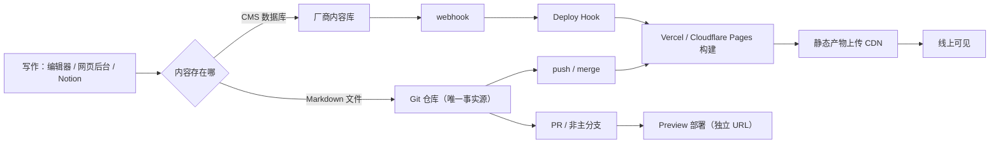
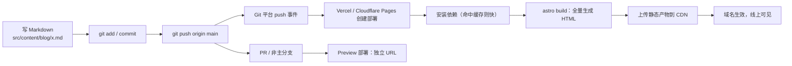
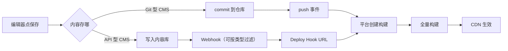
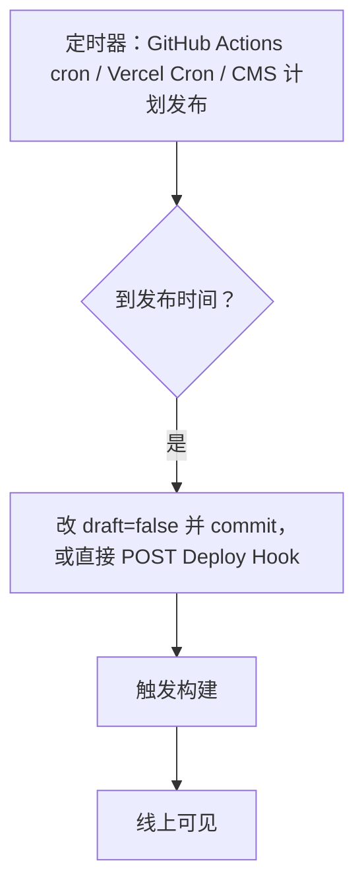
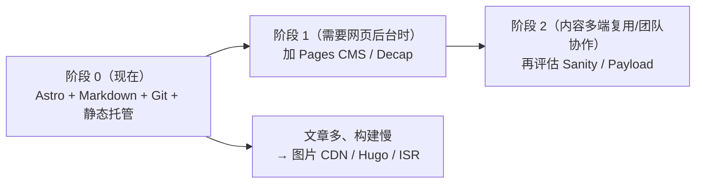

# 个人博客的内容更新与发布：工程实践调研

> **调研日期**：2026-10-29
> **适用范围**：以 Markdown/MDX 为主的个人博客与技术博客；基线是仓库 `kk-carp/my-site`（“林安的个人网站”，Astro + Tailwind 静态站），部署目标是 Vercel 或 Cloudflare Pages。同时覆盖“想要网页后台”“内容要被 App 复用”“要 newsletter”等分支场景。
> **一句话结论**：**现有站点已经选对了路：文章以 Markdown + frontmatter 存在 Git 仓库，用 Content Collections 约束字段，草稿在查询层过滤，构建后有 `verify` 校验。现在缺的不是 CMS，而是“自动部署 + RSS/sitemap/canonical/OG + CI 校验”这层基建；把这四件事补上，就是一个能长期维护的个人博客。网页后台（Pages CMS / Decap）等真的需要手机/他人发文时再加，内容零迁移。**

---

## 0. 调研说明与局限

- 本文优先引用**官方文档、官方仓库、规范与厂商定价页**；二手文章只用于发现线索，不作为结论依据。
- 受本次执行环境的网络抓取限制，无法逐页下载网页正文。因此本文：① **不抄录任何可能变动的免费额度、价格、构建时长数字**，统一给出官方链接并注明“以页面当前值为准”；② 真实案例给出**可复核的判据组合**（生成器指纹、feed 地址、公开仓库路径）与置信度，读者可在 30 秒内自行验证。
- 文中凡标“经验值”的耗时，是一般工程经验区间，**不是厂商 SLA**；请以自己项目的构建日志为准。
- 本文以仓库 `kk-carp/my-site` 为对照基线，源码事实来自 `package.json`、`astro.config.mjs`、`src/content.config.ts`、`src/lib/content.ts`、`src/pages/**`、`scripts/verify-build.mjs` 与 `README.md`。**Astro 主版本以 `package.json` / `package-lock.json` 实际解析为准，正文不写死版本号**；README 的 Astro 版本表述已落后于依赖（以锁文件为准，建议后续统一文档）。

---

## 1. 结论先行

### 1.1 给这位新手的默认答案

现有仓库已经把这套方案的大半做完了：Astro 静态输出、Content Collections、`draft` 查询过滤、构建后的 `verify` 校验。**不要换架构，先把剩下几块补上**：

1. **接自动部署**：GitHub 仓库 → Cloudflare Pages 或 Vercel，构建命令 `npm run build`、输出目录 `dist`，push 即上线。
2. **补 `site` 配置**：`astro.config.mjs` 里加正式域名；RSS、sitemap、canonical 都依赖它。
3. **补 RSS + sitemap + canonical + OG**：这是“博客像博客”的最低配置，也是当前站点最明显的缺口。
4. **加 CI 校验**：GitHub Actions 跑 `check → build → verify`，把现在“靠人记得跑”的检查自动化。
5. **发布流程保持不变**：写 md → `draft: false` → `npm run build && npm run verify` → commit/push。
6. **CMS 先不加**：等出现“手机/他人要发文章”的真实需求，再上 Pages CMS（最简）或 Decap（更完整），内容零迁移。
7. **内容契约别动**：`title / description / tags / draft / isExample / pubDate / author` 这套 schema 已经是资产；新增字段要同步 schema、列表、详情、RSS、sitemap 与 `verify`。

> 一句话：**站点已经选对了路，缺的是“上线 + SEO 基建 + 自动化校验”，不是 CMS。**

### 1.2 七条核心结论

1. **内容存哪里，比用什么框架更重要。** 存在 Git 里的 Markdown 可以换 10 个生成器；存在厂商内容库里的结构化 JSON，换一次要写迁移脚本。
2. **静态站没有“保存即上线”。** “保存”只发生在编辑器；“上线”必须经过一次构建 + 上传 + CDN 生效。CMS 的作用是帮你**触发**这次构建，不是跳过它。
3. **全量重建是静态站的默认行为。** Vercel / Cloudflare Pages 对纯静态框架都是整站重建；只有 Next.js 的 ISR / on-demand revalidation 能做到按页再生。文章从几十篇涨到几百篇后，构建时间会变成日常体验问题。
4. **Git 型 CMS 不是另一套内容库。** Decap / Tina / Pages CMS 都是“往 Git 仓库提交 Markdown 的网页表单”，内容仍然可 diff、可回滚、可迁移。
5. **API 型 headless CMS 是另一套内容库。** Sanity / Contentful / Storyblok / Payload 提供编辑界面、权限、草稿、预览和 API，但你必须自己写前端取数、自己配 webhook 触发构建、自己负责导出备份。
6. **Notion / Obsidian 是“写作工具”，不是“发布系统”。** Notion 缺发布钩子和稳定的图片 URL；Obsidian 缺网页后台但 Markdown 最纯。两者都要接一层 Git 或构建脚本才能上线。
7. **新手最容易低估的是维护，不是搭建。** 草稿误发布、图片撑爆仓库、webhook 静默失败、免费额度/商业条款、厂商锁定——这些都在“搭好之后”才出现。**对本仓库而言，最该先补的是自动部署、RSS/sitemap/canonical/OG 和 CI，而不是 CMS。**

**直接回答“新手能不能长期维护”**：能。日常要维护的对象只有三样：`src/content/blog/*.md`、`src/content.config.ts`、`astro.config.mjs`。只要不手工改 `dist/`、不把图片原图塞进 Git、不在没有预览的情况下直接改生产分支，这套结构可以撑到几百篇。真正的分水岭是“构建时间”和“多人协作”，不是文章数量本身。

### 1.3 一张图看懂全局



---

## 2. 五条路线对比

### 2.1 总表

| 路线 | 代表产品 | 编辑入口 | 内容存放 | 发布如何触发 | 上手难度 | 长期维护 | 免费/成本 | 适合谁 |
|---|---|---|---|---|---|---|---|---|
| A. 仓库内 Markdown + 静态生成器 | Astro、Next.js MDX、Hugo、Jekyll | 本地编辑器 / AI / VS Code | Git 仓库里的 `.md`/`.mdx` | `git push` → 平台自动构建 | 低（Astro/Hugo）/ 中（Next） | 最低：无数据库、无服务器 | 软件免费；静态托管有免费档，见 [Vercel 定价](https://vercel.com/pricing)、[Cloudflare Pages](https://developers.cloudflare.com/pages/) | 大多数个人博客、技术博客、AI 辅助写作 |
| B. Git 型 CMS | Decap CMS、TinaCMS、Pages CMS | 浏览器网页表单 | **仍是 Git 仓库里的 Markdown** | CMS 提交 commit → 平台构建；或 CMS 调 Deploy Hook | 低-中（OAuth 是唯一门槛） | 低：内容可 diff、可回滚、可搬走 | 开源免费；Tina Cloud/托管有付费档 | 不想天天开编辑器、但仍想保留 Git 的人 |
| C. API 型 headless CMS | Sanity、Contentful、Storyblok、Payload | 厂商后台 / 自建后台 | 厂商内容库（JSON/结构化字段） | 保存 → webhook → Deploy Hook → 构建 | 中-高 | 中：要管 API、预览、导出、备份 | 有免费档，超出后按坐席/用量，见各家 pricing | 内容要被 App/多端复用、团队协作、复杂内容模型 |
| D. 写作工具即 CMS | Notion、Obsidian + Git 插件 | Notion / Obsidian | Notion 数据库 / 本地 Markdown | 定时构建或手动 Deploy Hook；Obsidian 直接 push | 低 | 中-高：Notion 有锁定与图片过期；Obsidian 有同步冲突 | Notion 免费档 + API；Obsidian 个人免费 | 已经在 Notion/Obsidian 里写大量笔记的人 |
| E. 传统动态 CMS | WordPress、Ghost | 完整后台 | MySQL/SQLite 数据库 | 保存即发布（动态渲染），或调 API 重建静态 | 低（但运维中） | 中：要更新、备份、防攻击 | 软件免费；托管/服务器付费 | 要评论、插件、会员、newsletter、非技术团队 |

> 价格与额度随时变化，上表只给“是否有免费档”的判断；具体数字一律点链接看当前页面。

### 2.2 路线 A：仓库内 Markdown/MDX + 静态站点生成器

#### 各家的内容目录约定

| 生成器 | 内容放哪 | 文章元数据 | 草稿机制 | 列表/详情怎么取 | 构建命令 |
|---|---|---|---|---|---|
| **Astro**（推荐） | `src/content/blog/*.md` 或 `.mdx` | frontmatter，`src/content.config.ts` 用 Zod 定义 | 自己在 `getCollection` 里过滤 `draft` | `getCollection('blog')` + `render(entry)` | `astro build` → `dist/` |
| **Next.js（App Router）** | 常见 `content/blog/*.mdx`（也可用 `@next/mdx` 做文件路由） | frontmatter，自己解析（`gray-matter`）或 `next-mdx-remote` | 自己在 `generateStaticParams` 过滤 | `fs.readFile` + `MDXRemote`；或 `import()` | `next build` → `.next/`（静态导出为 `out/`） |
| **Hugo** | `content/posts/*.md`（可任意 section） | frontmatter（TOML/YAML/JSON） | 内置：`draft: true` 默认不构建，`-D` 才包含 | `.Pages` / `.Site.RegularPages` 模板 | `hugo --minify` → `public/` |
| **Jekyll** | `_posts/YYYY-MM-DD-slug.md`；草稿放 `_drafts/` | frontmatter（YAML） | 内置：`published: false`；`--drafts` 才渲染 `_drafts` | `site.posts` / `paginator` | `bundle exec jekyll build` → `_site/` |

官方依据：[Astro Content Collections](https://docs.astro.build/en/guides/content-collections/)、[Next.js MDX](https://nextjs.org/docs/app/guides/mdx)、[Hugo Content Management](https://gohugo.io/content-management/)、[Jekyll Posts](https://jekyllrb.com/docs/posts/)。

#### 实际操作步骤（以 Astro 为例）

```bash
# 1. 建站（已有项目跳过）
npm create astro@latest my-site

# 2. 定义集合（只需做一次）
#    src/content.config.ts
# 3. 写文章
#    src/content/blog/my-first-post.md
# 4. 本地预览（热更新）
npm run dev
# 5. 构建 + 本地验收
npm run build && npm run preview
# 6. 发布
git add src/content/blog/my-first-post.md
git commit -m "post: my-first-post"
git push origin main
```

`src/content.config.ts` 最小示例：

```ts
import { defineCollection, z } from 'astro:content';
import { glob } from 'astro/loaders';

const blog = defineCollection({
  loader: glob({ pattern: '**/*.{md,mdx}', base: './src/content/blog' }),
  schema: z.object({
    title: z.string(),
    description: z.string(),
    pubDate: z.coerce.date(),
    draft: z.boolean().default(false),
    tags: z.array(z.string()).default([]),
  }),
});

export const collections = { blog };
```

列表页过滤草稿（**关键**）：

```ts
import { getCollection } from 'astro:content';

const posts = (await getCollection('blog', ({ data }) => !data.draft))
  .sort((a, b) => b.data.pubDate.valueOf() - a.data.pubDate.valueOf());
```

#### 优点 / 缺点 / 适合谁 / 成本

- **优点**：零数据库、零服务器；内容可 diff、可回滚；AI 直接改 Markdown 不会碰坏后台；构建产物可托管在任何 CDN；迁移成本最低。
- **缺点**：默认没有网页后台（要给非技术编辑用就得加路线 B）；每次发布整站重建；评论/搜索/统计要外挂；本地要装 Node（Hugo 是单二进制，更省事）。
- **适合谁**：愿意用编辑器或 AI 写字的个人；以文章为主、页面结构稳定的博客。
- **成本/免费额度**：软件全免费；托管用 Vercel Hobby（**仅限个人、非商业用途**，见 [Vercel 定价](https://vercel.com/pricing)）或 Cloudflare Pages 免费档（见 [Pages  Limits](https://developers.cloudflare.com/pages/platform/limits/)）。花费主要是域名。

#### 四条子路线怎么选

| 子路线 | 优势 | 代价 | 什么时候选 |
|---|---|---|---|
| **Astro** | 内容集合 + 图片优化 +  islands，默认零 JS，和 Tailwind 顺 | 生态比 Next 小；重交互要写岛屿 | 个人博客默认选它 |
| **Next.js MDX** | 和 React 生态无缝；以后要做 App/登录/ISR 顺 | 概念多（RSC、缓存、MDX 两种接法），新手易迷路 | 确定以后要长成 Web App |
| **Hugo** | 单二进制、构建极快；模板稳定 | Go 模板要学；自定义交互弱 | 文章会很多、讨厌等构建 |
| **Jekyll** | GitHub Pages 原生；Ruby 生态老 | 构建慢、插件受 GitHub Pages 限制 | 只想用 GitHub Pages、不折腾 |

### 2.3 路线 B：Git 型 CMS（“网页后台，内容提交回 Git”）

共同点：**内容仍是仓库里的 Markdown**；CMS 只是一层网页表单 + 图片上传 + 提交（commit/PR）。因此换 CMS 不迁移内容，只换配置。

| 产品 | 配置方式 | 内容如何写回 | 预览 | 认证 | 成本 | 主要坑 |
|---|---|---|---|---|---|---|
| **Decap CMS**（原 Netlify CMS） | `public/admin/index.html` + `public/admin/config.yml` | GitHub/GitLab/Gitea API 提交；可开 editorial workflow 走 PR | PR → 平台 Preview 部署 | GitHub OAuth（要建 OAuth App）或平台网关 | 开源免费，见 [文档](https://decapcms.org/docs/) | 后台 UI 偏旧；OAuth 配置是新手第一道坎；无实时预览 |
| **TinaCMS** | `tina/config.ts` 定义 schema | Tina Cloud 或自托管服务提交到 Git | 可视化内联编辑 + 预览 | Tina Cloud 账号 / 自建 auth | 开源可自托管；Cloud 有付费档，见 [定价](https://tina.io/pricing) | 概念多、依赖 React；自托管要自己管 auth |
| **Pages CMS** | 仓库根目录 `.pages.yml` | GitHub API 直接 commit | 平台 Preview 部署 | GitHub 登录 | 开源/托管免费，见 [文档](https://pagescms.org/docs/) | 功能相对少；只适合结构简单的集合 |

#### 实际操作步骤（Decap，最典型的免费方案）

1. 在仓库加 `public/admin/index.html`（加载 Decap 的 CDN 脚本）与 `public/admin/config.yml`。
2. `config.yml` 里声明 `backend: github`、`repo`、`branch`，以及 `collections` 的 `folder` 指向 `src/content/blog`。
3. 在 GitHub 建 OAuth App，把 Client ID/Secret 接到 OAuth 代理（或 Netlify 的 Git Gateway）。
4. 打开 `https://你的域名/admin/` 登录，新增文章 → 保存 → Decap 提交 commit。
5. 平台检测到 push → 构建 → 上线；若开了 `publish_mode: editorial_workflow`，保存先变成 PR，合并才上线。
6. 本地开发用 `local_backend: true` + `npx decap-server`，不必每次都推远端。

`config.yml` 示意（字段要和 Astro 的 Zod schema 对齐）：

```yaml
backend:
  name: github
  repo: your-name/your-repo
  branch: main
publish_mode: editorial_workflow
media_folder: "public/images/uploads"
public_folder: "/images/uploads"
collections:
  - name: blog
    label: 博客
    folder: "src/content/blog"
    create: true
    fields:
      - { label: 标题, name: title, widget: string }
      - { label: 描述, name: description, widget: text }
      - { label: 日期, name: pubDate, widget: datetime }
      - { label: 草稿, name: draft, widget: boolean, default: true }
      - { label: 示例, name: isExample, widget: boolean, default: false }
      - { label: 作者, name: author, widget: string, default: 林安 }
      - { label: 标签, name: tags, widget: list, required: false }
      - { label: 正文, name: body, widget: markdown }
```

> 注意：上面 `media_folder` 指向 `public/`，图片不经过 Astro 的图片优化；想用 `<Image>` 就把上传目录改到 `src/assets`，并确认 Decap 写出的引用路径能被构建解析。字段名必须与 `src/content.config.ts` 完全一致，否则后台保存的文件会构建失败。

官方依据：[Decap 文档](https://decapcms.org/docs/)、[Editorial Workflows](https://decapcms.org/docs/editorial-workflows/)、[Collection Types](https://decapcms.org/docs/collection-types/)、[Tina 自托管](https://tina.io/docs/self-hosted/overview)、[Pages CMS 配置](https://pagescms.org/docs/configuration/)。

#### 优点 / 缺点 / 适合谁 / 成本

- **优点**：给非技术编辑一个网页后台；内容仍在 Git，**可 diff、可回滚、可随时删掉 CMS**；一般不需要数据库。
- **缺点**：多一层配置（OAuth、字段映射）；后台体验不如 Notion/Contentful；图片进仓库会让仓库变大；保存后仍要等构建。
- **适合谁**：自己会 Git，但偶尔想让别人（或自己在手机上）用网页改文章。
- **成本**：软件免费；Tina Cloud 等托管有免费档/付费档，以定价页为准。

### 2.4 路线 C：API 型 headless CMS

共同点：**内容存在厂商的内容库里**，通过 REST/GraphQL API 取数；编辑器保存后，用 webhook 调 Deploy Hook 触发重建。前端可以是 Astro（构建时取数）或 Next（SSR/ISR）。

| 产品 | 内容模型 | 查询方式 | 草稿/预览 | 发布触发 | 导出/锁定 | 免费档 |
|---|---|---|---|---|---|---|
| **Sanity** | 代码里的 schema（`defineType`） | GROQ / GraphQL | 草稿用 `drafts.` 前缀；Presentation 预览 | Webhook → Deploy Hook | `sanity dataset export`（NDJSON）；Portable Text 是自有格式 | 有免费档，见 [定价](https://www.sanity.io/pricing) |
| **Contentful** | 后台建 Content Model | REST / GraphQL | Draft → Published；Preview API | Webhook（可按 content type 过滤） | `contentful space export`；Rich Text 是自有 JSON | 有免费档，见 [定价](https://www.contentful.com/pricing/) |
| **Storyblok** | 组件（Block） | REST / GraphQL | Draft/Published 版本；Visual Editor | Webhook（如 `story.published`） | 管理 API 导出；Block JSON 自有格式 | 有免费档，见 [定价](https://www.storyblok.com/pricing) |
| **Payload** | 代码里的 collection 配置 | Local API / REST / GraphQL | 内置 drafts/versions；Live Preview | 自己写 afterChange hook 调 Deploy Hook | 数据在 Postgres/Mongo，可 `pg_dump`；开源可自托管 | 自托管免费；Cloud 付费，见 [定价](https://payloadcms.com/pricing) |

官方依据：[Sanity 文档](https://www.sanity.io/docs)、[Sanity Webhooks](https://www.sanity.io/docs/webhooks)、[Contentful 文档](https://www.contentful.com/developers/docs/)、[Contentful Webhooks](https://www.contentful.com/developers/docs/references/content-management-api/webhooks/)、[Storyblok 文档](https://www.storyblok.com/docs)、[Storyblok Webhooks](https://www.storyblok.com/docs/concepts/webhooks)、[Payload 文档](https://payloadcms.com/docs)、[Payload Live Preview](https://payloadcms.com/docs/live-preview/overview)。

#### 实际操作步骤（Sanity + Astro 为例）

```bash
npm create sanity@latest -- --project <id> --dataset production --template clean
# 在 Studio 里定义 post schema：title/slug/body/publishedAt
# Astro 侧安装 @sanity/client，构建时 GROQ 取数
```

1. 在 Sanity 项目里建 schema、写文章、点 Publish。
2. 在 Sanity 管理后台加 Webhook，URL 填 Vercel/Cloudflare 的 Deploy Hook，过滤 `_type == "post"`。
3. 前端构建时用 `client.fetch()` 取数，生成静态页；或 Next 用 ISR。
4. 保存 → webhook → 构建 → 上线；草稿在 Presentation 里预览。

#### 优点 / 缺点 / 适合谁 / 成本

- **优点**：编辑体验最好；结构化内容适合多端复用；权限、协作、版本、预览齐全；图片有 CDN。
- **缺点**：多一个外部依赖；要写取数层和 webhook；**内容不在 Git**，备份/迁移要额外做；富文本是各家自有 JSON，换厂商要转换；免费档有配额。
- **适合谁**：内容要同时供给网站 + App/小程序；多人协作；内容模型复杂（产品、案例、文档）。
- **成本**：均有免费档，按坐席/用量收费；以各家 pricing 页为准。

### 2.5 路线 D：写作工具即 CMS

| 方案 | 实际操作 | 优点 | 缺点 | 适合谁 |
|---|---|---|---|---|
| **Notion 作为内容源** | Notion 数据库当“文章表”；构建时用 Notion API 拉取 block，转 Markdown/HTML；定时或手动触发重建 | 写作体验最好；多人协作；已有笔记直接复用 | 不是为发布设计：图片是**带签名的临时 URL**（会过期），必须在构建时下载；有 API 速率限制；草稿靠 status 字段；发布钩子弱，通常要定时构建；导出后结构会丢 | 已经在 Notion 里写作、能接受“构建时快照”的人 |
| **Obsidian + Git 插件** | 把 vault 当仓库（或 vault 里的 `content/` 目录），用 [obsidian-git](https://github.com/Vinzent03/obsidian-git) 定时 commit/pull；push 触发构建 | 本地优先、纯 Markdown、离线可写、隐私好；和静态站天然契合 | 没有网页后台；手机端插件能力有限；多设备/多人易冲突；图片路径要约定 | Markdown 重度用户、喜欢本地文件的人 |

官方依据：[Notion API 文档](https://developers.notion.com/)、[Notion API 入门](https://developers.notion.com/reference/intro)、[Obsidian Git 插件仓库](https://github.com/Vinzent03/obsidian-git)。

**成本/免费额度**：Notion 有个人免费档，API 随套餐提供（以 [Notion 定价](https://www.notion.com/pricing) 为准）；Obsidian 个人使用免费，官方 Sync/Publish 为付费项，Git 插件开源免费。**适合谁**：已经在 Notion 里写作者，或喜欢本地 Markdown 文件的 Obsidian 用户；不适合要求“保存即上线”的人。

**Notion 的关键工程细节**（新手最容易踩）：

- 文件/图片 URL 是**短期签名 URL**，不能直接写进静态 HTML 长期用；构建时要下载到本地或转存对象存储。
- Notion 的 block 结构不是 Markdown；`notion-to-md` 之类的转换器只能覆盖常见块，复杂块（同步块、数据库视图、嵌入）会丢。
- 速率限制按平均请求数计算，文章多时要加缓存/并发控制；具体数值以 [官方文档](https://developers.notion.com/reference/request-limits) 为准。
- Notion 没有面向静态站的“发布”概念，常见做法是 **定时构建**（GitHub Actions schedule / Vercel Cron）或手动点 Deploy Hook。

### 2.6 路线 E：传统动态 CMS（对照）

| 产品 | 技术形态 | 发布方式 | 优点 | 缺点 | 什么场景仍值得用 |
|---|---|---|---|---|---|
| **WordPress** | PHP + MySQL，主题/插件生态 | 后台点“发布”，PHP 动态渲染；也可 headless 走 REST API | 插件多（评论、SEO、表单、电商）；非技术用户熟悉；托管商多 | 要服务器、要更新、要防攻击；速度依赖缓存插件；主题/插件质量参差 | 需要评论/论坛/电商/复杂插件；不想碰 Git；愿意付托管费 |
| **Ghost** | Node.js + MySQL/SQLite | 后台发布，动态渲染；自带会员/订阅 | 写作与 newsletter 体验好；官方托管省心；主题简洁 | 生态比 WordPress 小；自托管要维护 Node/DB；内容在数据库 | 以 newsletter/付费订阅为主的独立写作者 |

官方依据：[WordPress 文档](https://wordpress.org/documentation/)、[Ghost 文档](https://ghost.org/docs/)、[Ghost 定价](https://ghost.org/pricing/)。

**成本/免费额度**：WordPress 软件本身免费，支出是域名 + 主机（或托管服务）；Ghost 自托管软件免费但需要服务器，Ghost Pro 是订阅制。具体价格以 [WordPress 主机商](https://wordpress.org/hosting/) 与 [Ghost 定价](https://ghost.org/pricing/) 页面为准。**适合谁**：要评论/会员/插件/非技术团队的人；**不适合**只想写静态文章的人。

> 对照结论：如果你**不需要**评论、会员、插件，动态 CMS 的服务器和更新就是纯负担；如果你**需要**这些，静态站要逐个外挂（Giscus、Buttondown、Algolia…），反而不如直接用 Ghost/WordPress。

---

## 3. 发布链路详解：从“点保存”到“线上可见”

### 3.1 纯 Git 流程



**每一步实际发生什么：**

| 步骤 | 发生什么 | 失败会怎样 |
|---|---|---|
| 写文件 | frontmatter + 正文落盘；本地 `npm run dev` 可热更新 | schema 不匹配时 `astro build` 报错 |
| commit | 生成一个可回滚的内容快照 | 忘记 `git add`，commit 为空 |
| push | Git 平台产生 push 事件 | 推错分支 → 只出 Preview，不上线 |
| 平台创建部署 | 读取仓库、应用构建配置与环境变量 | 构建命令/输出目录配错 → 部署失败 |
| 安装依赖 | `npm ci`；有 lockfile 才能复现 | lockfile 漂移 → 本地能跑、线上报错 |
| 构建 | Astro 读集合 → 渲染每篇文章 → 处理图片 → 生成 `dist/` | 任一篇 frontmatter 非法 → 整站构建失败 |
| 上传 + CDN | 产物上传、缓存失效、边缘节点生效 | 缓存策略异常 → 短时间旧页面 |

**Vercel 与 Cloudflare Pages 的 Git 集成差异：**

| 维度 | Vercel | Cloudflare Pages |
|---|---|---|
| 触发 | 连接 Git 仓库；推送到 Production Branch 自动生产部署，其他分支/PR 自动 Preview | 连接 GitHub/GitLab；Production Branch 自动生产部署，其他分支自动 Preview |
| 构建配置 | Framework Preset、Build Command、Output Directory、Root Directory、环境变量 | Build Command、Build Output Directory、Root Directory、环境变量 |
| 预览 | 每个 PR/分支一个 Preview URL | 每个非生产分支一个 Preview URL |
| 回滚 | 控制台把历史部署提升为生产（无需重建） | 回滚到上一次成功部署 |
| 跳过构建 | Ignored Build Step（按变更路径决定是否构建） | Build Watch Paths（只监听指定路径） |
| 纯静态增量 | 无：每次部署整站重建 | 无：每次部署整站重建 |
| 官方文档 | [Git 集成](https://vercel.com/docs/deployments/git)、[Deploy Hooks](https://vercel.com/docs/deployments/deploy-hooks)、[Preview](https://vercel.com/docs/deployments/preview-deployments) | [Git 集成](https://developers.cloudflare.com/pages/get-started/git-integration/)、[Build Hooks](https://developers.cloudflare.com/pages/configuration/build-hooks/)、[Build Watch Paths](https://developers.cloudflare.com/pages/configuration/build-watch-paths/) |

> **本仓库现状**：目前只完成了图中“写 Markdown → commit → push”的前半段；push 之后没有平台接住（没有 CI、没有托管连接）。所以第一次部署要先做 §6.3 的 P0，之后这张表才真正生效。

### 3.2 CMS 流程



**两种 CMS 的链路差别（很重要）：**

- **Git 型 CMS（Decap / Tina / Pages CMS）**：保存 = 产生一个 commit（或 PR）。平台本来就在监听 Git，**通常不需要额外 webhook**；开了 editorial workflow 时，PR 阶段就有 Preview，合并才上生产。
- **API 型 CMS（Sanity / Contentful / Storyblok / Payload）**：保存 = 写数据库，**Git 完全不知道**。必须在 CMS 里配 webhook → 调平台的 Deploy Hook，否则线上永远不变。
- **Deploy Hook 是什么**：一个带密钥的 URL，向它发 `POST` 就会触发指定分支的新部署。Vercel 在项目设置里创建；Cloudflare Pages 在 Settings → Build hooks 创建。它应当被当作密码对待（泄露 = 别人可以烧你的构建额度）。

**“增量构建 / ISR / 按需重建”的真相：**

| 组合 | 是否有按页增量 | 说明 |
|---|---|---|
| Astro 纯静态 + Vercel/Cloudflare | ❌ | 每次部署全量渲染；图片优化也在构建期做 |
| Hugo 纯静态 | ❌ | 全量，但单页成本极低，几百篇通常仍是秒级 |
| Next.js + Vercel | ✅ ISR / on-demand revalidation | `revalidate` 到期后台再生，或 `revalidatePath`/`revalidateTag` 主动失效；这是“CMS 保存后只重建一页”的唯一主流方案 |
| Next.js 静态导出（`output: 'export'`） | ❌ | 导出后就是纯静态，失去 ISR |
| Astro SSR / 按需渲染 | 运行时渲染 | 需要 adapter；不是“构建”，而是每次请求算；可配合缓存 |
| Cloudflare Pages + Functions | 手动 | 没有 Next 式 ISR；要自己用 KV/Cache API 做缓存 |

官方依据：[Next.js ISR](https://nextjs.org/docs/app/guides/incremental-static-regeneration)、[revalidatePath](https://nextjs.org/docs/app/api-reference/functions/revalidatePath)、[Astro 按需渲染](https://docs.astro.build/en/guides/on-demand-rendering/)。

### 3.3 一篇文章改完到线上，典型要多久？

以下为**经验区间**，不是任何厂商的 SLA：

| 阶段 | 典型量级 | 影响因素 |
|---|---|---|
| 保存/commit/push | 1–5 秒 | 网络、图片大小 |
| 平台排队 | 0–30 秒 | 免费档并发、同一分支连续推送会排队/取消旧构建 |
| 安装依赖 | 10–60 秒 | 是否命中缓存、lockfile 是否变化 |
| 构建 | 10 秒–5 分钟 | 页面数、图片数量与尺寸、框架 |
| 上传 + CDN 生效 | 5–60 秒 | 产物大小、边缘缓存 |
| **合计（小型站）** | **约 1–5 分钟** | 100 篇以内、图片优化适中 |
| **合计（大型站）** | **5–15 分钟** | 数百篇 + 大量图片；免费档排队更久 |

**全量重建在文章变多后的代价：**

- 构建时间随页面数近似线性增长；**图片处理往往比渲染更贵**（Astro 在构建期对本地图片做 resize/转格式）。
- 每次改一个错别字也要重建全站 → 消耗构建额度、占用并发、拖慢“保存到上线”的反馈。
- CMS 连续保存会触发多次构建；需要**去抖**（webhook 过滤、平台自动取消旧构建、或只在 merge 时构建）。
- 缓解顺序：**先优化图片 → 再用 Hugo/更轻的模板 → 再考虑 ISR/SSR → 最后才拆站**。

**给新手的判断线**：如果 `npm run build` 稳定超过 3 分钟，且你一周发布少于 3 篇，先别上复杂架构，先把图片从仓库挪走或压缩；如果超过 10 分钟，再考虑 Hugo/ISR/拆站。

### 3.4 定时发布链路

静态站没有“到点自动上线”的天然能力，因为页面是构建时生成的。三种可靠做法：



| 做法 | 怎么做 | 优点 | 坑 |
|---|---|---|---|
| **A. CMS 原生计划** | WordPress/Ghost/Sanity 等自带“定时发布” | 最省心 | 静态前端仍需 webhook 触发重建，否则页面不变 |
| **B. GitHub Actions 定时改稿** | `schedule` 跑脚本：把 `pubDate <= now` 的 `draft: true` 改成 `false`，commit + push | 内容仍在 Git，逻辑透明；公开仓库 Actions 免费 | cron 用 UTC；GitHub 可能延迟；要防重复提交（无变更不 commit） |
| **C. 定时调 Deploy Hook** | cron 直接 `curl -X POST <deploy-hook>`；构建时按 `pubDate` 过滤未来文章 | 不改内容，只重建 | 每次重建全站；必须让构建脚本按时间过滤，否则未来文章提前泄露 |

**关键细节**：如果只在模板里判断 `pubDate <= now`，而不触发重建，文章到点也不会出现；如果构建时不过滤，未来文章会**提前出现在 HTML 里**。两件事必须同时做。

GitHub Actions 的定时语法与限制见 [官方文档](https://docs.github.com/en/actions/reference/workflows-and-actions/events-that-trigger-workflows)；Vercel Cron 见 [Cron Jobs](https://vercel.com/docs/cron-jobs)。

---

## 4. 日常维护清单（可直接照做）

### 4.1 草稿与预览

- [ ] frontmatter 统一有 `draft: boolean`，默认 `true`。
- [ ] 所有列表/详情/RSS/sitemap 生成前都过滤 `draft`（**四处都要过滤，漏一处就泄露**）。**本站现状：列表与详情已通过 `src/lib/content.ts` 过滤；RSS/sitemap 尚未实现，新增时必须同样过滤。**
- [ ] 本地预览：`npm run dev` 时显示草稿；生产构建时不显示（用 `import.meta.env.PROD` 判断）。
- [ ] 每篇文章走 PR：PR 自动出 Preview URL，确认排版/图片/链接后再 merge。
- [ ] 需要密码保护预览：Vercel 的 Deployment Protection / Cloudflare Access（额度以官方文档为准）。
- [ ] Decap 用户开 `publish_mode: editorial_workflow`，让“保存”先变成 PR。

### 4.2 定时发布

- [ ] 选一种：CMS 原生计划 / GitHub Actions 改稿 / cron 调 Deploy Hook。
- [ ] 统一用 UTC 存 `pubDate`，展示时再转本地时区。
- [ ] 构建时过滤 `pubDate > now`，并确保定时任务真的触发了构建。**本站现状：`publishedPosts()` 只过滤 `draft`，没有过滤未来时间；现在写一个未来日期会立即上线。要用定时发布，先补这层过滤。**
- [ ] 发布后检查 RSS 是否也按时间过滤（RSS 泄露未来文章很常见）。

### 4.3 图片处理

| 做法 | 适用 | 优点 | 缺点 |
|---|---|---|---|
| `public/` 直接放图 | 极简站、图很少 | 最简单，路径即 URL | 不做压缩/转格式；大图直接拖慢首屏；仓库膨胀 |
| `src/assets` + Astro `<Image>` | 大多数博客（推荐） | 构建期压缩、转 WebP/AVIF、生成宽高防抖动、文件名带 hash | 构建变慢；图片必须走 import 或 `image()` |
| 图床 / 对象存储（S3、R2） | 图多、多站点复用 | 仓库轻；可独立 CDN | 多一个服务；要管权限/费用 |
| 图片 CDN（Cloudinary、imgix、Cloudflare Images） | 需要实时裁剪/响应式 | 自动格式/尺寸、全球 CDN | 免费档有限，按用量计费，见 [Cloudflare Images 定价](https://developers.cloudflare.com/images/pricing/) |

**规则（照做）：**

- [ ] 单张图先压到 200 KB 以内再入库；原图另存本地/对象存储。
- [ ] 正文图先压缩，放 `src/assets/blog/<id>/`；封面/组件里用 `<Image>` 输出，纯 `.md` 正文图至少手动压缩（是否走 Astro 图片优化，以 [Astro 图片文档](https://docs.astro.build/en/guides/images/) 为准）。
- [ ] `public/` 只放 favicon、robots.txt 等不需要处理的文件。
- [ ] 外链图（Notion、图床）在构建时下载，避免签名 URL 过期。
- [ ] 给每张图写 `alt`；宽高比固定，防 CLS。

### 4.4 RSS / sitemap / SEO

| 框架 | RSS | sitemap |
|---|---|---|
| Astro | `@astrojs/rss`，`src/pages/rss.xml.ts` | `@astrojs/sitemap` 集成，需配 `site` |
| Next.js | `app/blog/rss.xml/route.ts` 手写 XML | `app/sitemap.ts` / `app/robots.ts` |
| Hugo | 内置 RSS 输出 | 内置 sitemap，`enableRobotsTXT` |
| Jekyll | `jekyll-feed` 插件 | `jekyll-sitemap` 插件 |

官方依据：[Astro RSS](https://docs.astro.build/en/guides/rss/)、[Astro Sitemap](https://docs.astro.build/en/guides/integrations-guide/sitemap/)、[Next.js Sitemap](https://nextjs.org/docs/app/api-reference/file-conventions/metadata/sitemap)、[RSS 2.0 规范](https://www.rssboard.org/rss-specification)、[Sitemap 协议](https://www.sitemaps.org/protocol.html)。

> **本站现状：以下 6 项全部缺失**（`site`、RSS、sitemap、canonical、OG、robots.txt）。按 §6.3 的 P1 顺序补，不要一次全上。

- [ ] `astro.config.mjs` 配 `site: 'https://你的域名'`（RSS/sitemap/canonical 都依赖它）。
- [ ] 每篇有唯一 `description`，用作 meta description 和 RSS summary。
- [ ] 详情页输出 canonical、OG title/description/image。
- [ ] `robots.txt` 指向 sitemap；预览部署加 `noindex`（否则 Google 可能收录预览页）。
- [ ] 改 URL 必须 301；静态站用 `vercel.json` / `_redirects` 配重定向。
- [ ] RSS 只输出最近 N 篇，避免文件无限增长。

### 4.5 内容迁移与厂商锁定

| 方案 | 锁定程度 | 导出方式 | 换方案要做什么 |
|---|---|---|---|
| Markdown + Git | 极低 | 仓库本身就是导出 | 换生成器即可 |
| Git 型 CMS | 极低 | 同仓库 Markdown | 删掉 CMS 配置 |
| Payload（自托管） | 中 | `pg_dump` / Mongo dump | 重建 collection 配置，写字段映射 |
| Sanity | 中 | `sanity dataset export`（NDJSON） | 富文本 Portable Text → 目标格式 |
| Contentful | 中-高 | `contentful space export` | Rich Text JSON 转换；模型重建 |
| Storyblok | 中-高 | Management API 导出 | Block JSON 转换 |
| Notion | 高 | 官方 Markdown/HTML 导出 | 结构丢失、图片要重新下载 |
| WordPress | 中 | WXR 导出 | 主题/短代码要重做 |
| Ghost | 中 | JSON 导出 | 主题/会员数据要迁移 |

- [ ] 选型时把“**能否一键导出全部内容**”当硬指标。
- [ ] 富文本尽量用 Markdown；Portable Text/Rich Text JSON 只在确实需要结构化嵌入时用。
- [ ] 上线第一天就定 URL 规则，之后只增不改；必须改就做 301 映射表。
- [ ] 迁移前先跑一遍“导出 → 本地构建 → 对比页面数/链接”，再切 DNS。

### 4.6 备份

- [ ] Git 仓库至少两个远端（GitHub + GitLab/自建），或每周 `git bundle` 到本地/对象存储。**本站现状：只有 `origin` 一个远端，建议加一个镜像远端或每周 bundle。**
- [ ] API CMS 每月导出一次（Sanity NDJSON / Contentful JSON / Postgres dump），存到与厂商无关的地方。
- [ ] 图片原图单独备份（CDN 上的不是备份）。
- [ ] 每季度做一次“从备份恢复”演练；没恢复过的备份不算备份。
- [ ] 域名、DNS、OAuth App、Deploy Hook 的归属账号写进密码管理器，避免“人走站亡”。

### 4.7 依赖与安全

- [ ] 提交 `package-lock.json` / `pnpm-lock.yaml`，CI 用 `npm ci`。
- [ ] 固定 Node 版本（`.nvmrc` / `engines`），避免“本地能跑线上挂”。
- [ ] 每月 `npm outdated` + Dependabot；Astro/Next 大版本升级单独开 PR。
- [ ] 不在仓库里放密钥；Deploy Hook、CMS token 用环境变量。
- [ ] WordPress/Ghost 自托管：自动更新 + 备份 + 最小插件集。

---

## 5. 真实案例

> 说明：以下“判断依据”均为可在 30 秒内复核的公开线索。受本次环境抓取限制，未直接下载页面正文；置信度按“公开仓库 + 已知指纹”的可靠程度标注。

| 站点 | 方案 | 判断依据 | 可复制点 | 置信度 |
|---|---|---|---|---|
| [overreacted.io](https://overreacted.io/)（Dan Abramov） | Gatsby + Markdown，纯静态 | 页面 `<meta name="generator" content="Gatsby ...">`；feed 在 [`/rss.xml`](https://overreacted.io/rss.xml)；公开仓库 [gaearon/overreacted.io](https://github.com/gaearon/overreacted.io)，文章在 `src/pages/*.md` | 文章即页面文件；RSS 由插件生成；无数据库 | 高 |
| [kentcdodds.com](https://kentcdodds.com/blog) | Remix + MDX，服务端渲染 + 构建 | 公开仓库 [kentcdodds/kentcdodds.com](https://github.com/kentcdodds/kentcdodds.com)；`content/blog/*.mdx`；feed [`/blog/rss.xml`](https://kentcdodds.com/blog/rss.xml) | 内容与代码同仓；MDX 里可用 React 组件；构建时读文件 | 高 |
| [taniarascia.com](https://www.taniarascia.com/) | Gatsby + React + Node，纯静态 | 公开仓库 [taniarascia/taniarascia.com](https://github.com/taniarascia/taniarascia.com)（描述即 “running on Gatsby, React, and Node.js”）；文章在 `content/posts/*.md`；页面有 Gatsby 指纹 | 经典 `content/posts` + GraphQL 取数；适合从零照抄 | 高 |
| [simonwillison.net](https://simonwillison.net/) | Django + SQLite，动态 CMS（对照） | 公开仓库 [simonw/simonwillisonblog](https://github.com/simonw/simonwillisonblog)；文章存数据库；feed [`/atom/everything/`](https://simonwillison.net/atom/everything/)；响应为服务端渲染 | 动态站也能长期维护，但需要服务器、DB、备份与运维 | 高 |
| [astro.build/blog](https://astro.build/blog/) | Astro + Content Collections | 公开仓库 [withastro/astro.build](https://github.com/withastro/astro.build)；`src/content/` 下按集合组织文章；页面有 Astro 指纹；feed `/rss.xml` | 与目标栈完全一致；可直接看官方怎么组织内容 | 中-高 |

### 5.1 案例拆解

**overreacted.io —— “一个人 + 一个仓库”的极限**

- 每篇文章就是一个 Markdown 文件，frontmatter 只有标题、日期等少量字段；没有后台、没有数据库。
- 发布 = push；构建 = Gatsby 把 md 变成 HTML；RSS 由 `gatsby-plugin-feed` 生成。
- 可复制点：**文章数少于几百、只有作者一人时，这就是最省心的架构**；不要为了“以后可能多人”提前上 CMS。

**kentcdodds.com —— 内容与代码同仓的 MDX 模式**

- `content/blog/*.mdx` 与 `app/` 代码在同一个仓库；文章里可以直接用 React 组件（提示框、代码块、视频）。
- 代价是构建更重、对框架版本更敏感；适合作者本身是开发者、愿意维护代码的情况。
- 可复制点：**MDX 适合“文章里要嵌入交互”**；纯文字博客用纯 Markdown 更稳。

**taniarascia.com —— 经典 Gatsby 内容目录**

- `content/posts` 放 Markdown，Gatsby 用 GraphQL 在构建时取数生成页面。
- 这类结构与 Astro Content Collections 的心智模型几乎一样：**目录即数据库，frontmatter 即字段**。
- 可复制点：先把 `content/posts` 的字段定死，再谈页面设计。

**simonwillison.net —— 动态 CMS 的长期样本**

- Django + SQLite，文章在数据库里；发布是写 DB，页面是请求时渲染；有全文搜索、标签、引用等复杂功能。
- 它证明“动态 CMS 也能维护十几年”，但代价是服务器、数据库迁移、备份和安全更新。
- 对照结论：**如果你要的功能只是“文章列表 + 详情 + RSS”，静态站足够；不要因为“动态更灵活”而背服务器。**

**astro.build/blog —— 和目标栈一致的官方样本**

- Astro 官方博客用 Content Collections 组织文章，构建产物是静态 HTML。
- 可复制点：直接看它的 `src/content/` 目录、schema 和列表页写法，比看教程快。

### 5.2 如何 30 秒验证任意博客

1. 打开页面，`Ctrl+U` 查看源代码，搜索 `generator`：常见值有 `Astro`、`Gatsby`、`Next.js`、`Hugo`、`Jekyll`。
2. 访问 `/rss.xml`、`/feed.xml`、`/atom.xml`，看是否存在及生成方式。
3. 看响应头：`server`、`x-vercel-id`、`cf-ray`、`x-powered-by` 能暴露托管方/框架。
4. 在 GitHub 搜索站点域名或作者名，找公开仓库，直接看内容目录。
5. 看页面里是否有 `/_next/`、`/_astro/`、`/assets/` 等构建产物路径。

---

## 6. 对照现有站点（基线：林安的个人网站）

> 基线仓库：<https://github.com/kk-carp/my-site>（`main` 分支）。本节结论来自当前源码：`package.json`、`astro.config.mjs`、`src/content.config.ts`、`src/lib/content.ts`、`src/pages/blog/*`、`scripts/verify-build.mjs`、`README.md`，以及“仓库内没有 `.github/workflows`”这一事实。**版本号以 `package.json` / `package-lock.json` 为准。**

### 6.1 现状盘点

| 能力 | 现状 | 证据 |
|---|---|---|
| 框架与输出 | Astro 静态输出（`output: 'static'`）、Tailwind CSS v4、astro-icon/Lucide；`trailingSlash: 'always'` | `astro.config.mjs` |
| 内容模型 | Content Collections：`blog` / `projects`，`glob` loader，Zod schema（`title / description / tags / draft / isExample / pubDate / author`；projects 另有 `order / cover / role / link`） | `src/content.config.ts` |
| 路由 | `/blog/`、`/blog/[id]/`、`/projects/`、`/projects/[id]/`、`404` | `src/pages/**` |
| 草稿隔离 | 列表与详情都调用 `publishedPosts()` / `publishedProjects()` 过滤 `draft`；`verify` 断言草稿路由不存在、草稿标题不出现 | `src/lib/content.ts`、`scripts/verify-build.mjs` |
| 构建校验 | `npm run build` → `dist/`；`npm run verify` 检查路由、内部链接/资源、日期倒序、Markdown 代码块、草稿泄漏 | `package.json`、`scripts/verify-build.mjs` |
| 发布方式 | 手动：`build → verify → git add/commit/push` | `README.md` |
| 自动部署 | **没有**：无 CI、无托管平台连接、无 Deploy Hook；README 明确“尚未部署网站” | 无 `.github/workflows`；`README.md` |
| SEO 基建 | **缺** `site` 配置、RSS、sitemap、canonical、OG/Twitter 卡片、`robots.txt` | `astro.config.mjs` 只有 `output/trailingSlash/integrations/vite/markdown`；`BaseLayout.astro` 的 SEO 相关标签只有 `description` 与 `title` |
| 网络条件 | git 全局代理 `http://127.0.0.1:7890`；代理未开时 `git push` 失败（本机实测）；跨境访问 GitHub/Vercel/Cloudflare 可能不稳定 | `git config --global --get http.proxy`、`git remote -v` |
| 其他 | 依赖里有 `@astrojs/node`，但配置未启用 adapter（静态输出不受影响）；README 的 Astro 版本表述落后于实际依赖，且仍写“尚未部署” | `package.json`、`README.md` |

> 两个容易混淆的点：① `isExample: true` 只控制页面上“示例文章”的提示，**不会隐藏文章**；真正隐藏要用 `draft: true`。② `scripts/verify-build.mjs` 里硬编码了示例路由（`expected` 数组），删除/重命名示例文章时要同步改它，否则 `npm run verify` 会失败——这是这套“构建后校验”的维护成本。

### 6.2 五条路线逐条判定

| 路线 | 判定 | 理由 | 如果要动，动什么 |
|---|---|---|---|
| **A. 仓库内 Markdown + 静态生成器** | **现状即如此** | 已经是 Astro Content Collections + Markdown + 静态输出；草稿查询过滤和 `verify` 都在，README 也写清了发布步骤 | 不换架构，只补“自动部署 + SEO 基建 + CI” |
| **B. Git 型 CMS** | **可平滑升级** | 内容就是 `src/content/blog/*.md`；Pages CMS / Decap 可以直接编辑同一目录，零内容迁移，删掉 CMS 也不影响站点 | 加 `.pages.yml`（Pages CMS，最简）或 `public/admin/config.yml`（Decap，功能更全）+ GitHub OAuth；先只给 blog 集合开 |
| **C. API 型 headless CMS** | **现阶段不值得动** | 单人、纯文章、无多端复用、无复杂内容关系；引入后要写取数层、webhook、预览、导出备份，维护面成倍增加 | 等到“内容要被 App/小程序/多站点复用”或“多人协作 + 复杂内容模型”再评估 |
| **D. 写作工具即 CMS** | **Notion 现阶段不值得动；Obsidian 可平滑升级** | Notion 图片 URL 会过期、发布钩子弱、锁定高；Obsidian vault 本身是 Markdown，可把 `src/content/blog` 当作 vault 子目录 + git 插件 | 若已重度用 Obsidian：vault 指向仓库/子目录，装 obsidian-git；否则跳过 |
| **E. 传统动态 CMS** | **现阶段不值得动** | 不需要评论/会员/插件；静态站已满足，动态 CMS 反而增加服务器、更新、备份、防攻击负担 | 只有当“评论/会员/newsletter/插件”成为硬需求，才考虑 Ghost/WordPress |

### 6.3 下一步路线图（按优先级，可直接照做）

**P0：先让网站真的上线（约 1–2 小时）**

1. 选托管：Cloudflare Pages 或 Vercel，导入 `kk-carp/my-site`。个人博客两者都够；注意 Vercel Hobby 有“个人、非商业用途”限制，Cloudflare Pages 免费档的条款不同——以后要接广告/赞助前先核对当前条款。
2. 构建配置：Framework 选 Astro；Build command `npm run build`；Output directory `dist`；Root directory 留空（仓库根就是项目根）。
3. Node 版本：`package.json` 要求 `>=22.12.0`。Vercel 在项目设置里选 Node 版本；Cloudflare Pages 用 `NODE_VERSION` 环境变量（或提交 `.nvmrc`）。
4. 生产分支 `main`；push 后自动构建。首次成功后得到 `*.pages.dev` / `*.vercel.app` 域名。
5. 绑定自定义域名（可选），先验证 HTTPS、`/blog/` 和 `/blog/<id>/` 是否 200。
6. 把 README 的“尚未部署”改成实际地址（只改文档，不动 `src/`）。

**P1：补齐 SEO 与发布安全网（约半天）**

1. `astro.config.mjs` 加 `site: 'https://你的域名'`——canonical、sitemap、RSS 都依赖它。
2. sitemap：`npx astro add sitemap`，确认构建后有 `dist/sitemap-index.xml`。
3. RSS：`npm install @astrojs/rss`，新建 `src/pages/rss.xml.ts`；**必须过滤 `draft` 和未来的 `pubDate`**。
4. `BaseLayout.astro` 加 canonical、OG/Twitter 标签与 `og:image`（可先共用一张静态图）。
5. `public/robots.txt` 指向 sitemap；预览部署加 `noindex`。
6. GitHub Actions：`npm ci → npm run check → npm run build → npm run verify`，防止“本地能跑、线上挂”。模板见附录 A。

**P2：按信号升级（不预先做）**

- 出现“人在外面/手机上想发文章” → **Pages CMS**（最简）或 **Decap**（要 editorial workflow）。
- 出现“文章多、构建稳定 > 5 分钟” → 图片压缩/CDN → Hugo → ISR/SSR。
- 出现“内容要给 App/小程序/多个站点用” → Sanity / Payload。
- 出现“要评论/会员/newsletter” → Giscus / Buttondown 等外挂，或 Ghost/WordPress。

### 6.4 部署与网络现实约束

- **代理是硬依赖**：本机 `git config --global http.proxy = http://127.0.0.1:7890`。代理软件没开时 `git push` 直接失败（已实测）。发布前先确认：
  ```bash
  git config --global --get http.proxy
  # 输出 http://127.0.0.1:7890 说明代理已配置；确认代理软件正在运行
  ```
- **跨境网络**：GitHub、Vercel、Cloudflare 在中国大陆的访问/构建回源可能不稳定，这不是代码问题。若主要读者在国内，别把上线日押在跨境平台上。三种应对：
  1. 继续用 Vercel/Cloudflare，失败时换网络/重试；
  2. 国内静态托管（阿里云 OSS / 腾讯云 COS + CDN）——自定义域名通常需要 ICP 备案，按厂商要求办理；
  3. 本地 `npm run build` 后手动上传 `dist/` 到任意静态托管——最不依赖 CI，但每次发布多一步。
- **没有 CI 的风险**：现在 `npm run verify` 靠人记得跑；一旦忘记，草稿泄漏、断链、日期顺序错乱只能上线后才发现。P1 的 GitHub Actions 就是把这个检查自动化。
- **不要把 `dist/` 提交进仓库**：构建产物应由平台生成；仓库只存源码与内容。

### 6.5 当前缺口清单（照做）

| 项 | 现状 | 补法 | 优先级 |
|---|---|---|---|
| 自动部署 | ❌ | 接 Cloudflare Pages / Vercel，`npm run build` + `dist` | P0 |
| 自定义域名/HTTPS | ❌ | 平台绑定域名 | P0 |
| `site` 配置 | ❌ | `astro.config.mjs` 加 `site` | P1 |
| RSS | ❌ | `@astrojs/rss` + `src/pages/rss.xml.ts` | P1 |
| sitemap | ❌ | `@astrojs/sitemap` 集成 | P1 |
| canonical | ❌ | `BaseLayout.astro` 用 `Astro.site` + `Astro.url.pathname` 拼 | P1 |
| OG/Twitter 卡片 | ❌ | `og:title/description/image`、`twitter:card` | P1 |
| robots.txt | ❌ | `public/robots.txt` 指向 sitemap | P1 |
| CI 校验 | ❌ | GitHub Actions 跑 `check/build/verify` | P1 |
| 草稿过滤 | ✅ | 保持；新增 RSS/sitemap 时继续过滤 | — |
| 未来文章过滤 | ❌ | `publishedPosts()` 加 `pubDate <= now`；RSS/sitemap 复用同一函数 | P2（要定时发布时） |
| 构建后校验 | ✅ | 保持 `npm run verify` | — |
| 404 页面 | ✅ | 保持 | — |

> **关键提醒**：新增 RSS/sitemap 后，“草稿过滤”的地方从 2 处（列表、详情）变成 4 处（列表、详情、RSS、sitemap）。`verify-build.mjs` 目前只断言草稿路由与页面文本；建议后续把“RSS 中不出现草稿”也加入断言。

---

## 7. 给新手的决策矩阵与迁移路径

### 7.1 决策矩阵

| 你的情况 | 选什么 | 为什么 | 现在要做的 |
|---|---|---|---|
| 完全新手，主要自己写，AI 改代码 | **Astro + Content Collections + Git + Vercel/Cloudflare Pages** | 无服务器、无数据库、内容可迁移、AI 友好 | **本仓库已在此方案上**；补自动部署 + RSS/sitemap/canonical/OG + CI（§6.3） |
| 自己写，但想让别人/手机网页编辑 | Astro + **Pages CMS**（最简）或 **Decap** | 仍是同一批 Markdown，零迁移 | 加 `.pages.yml` 或 `admin/config.yml` |
| 要可视化拖拽、营销落地页 | **TinaCMS** 或 **Storyblok** | 内联编辑/组件化 | 接受 schema 与配置复杂度 |
| 内容要给 App/小程序复用 | **Sanity** 或 **Payload** | API 优先、结构化 | 设计内容模型 + webhook + 预览 |
| 主要写 newsletter / 付费订阅 | **Ghost** | 会员、订阅、邮件内置 | 直接上 Ghost Pro 或自托管 |
| 要评论、插件、电商、非技术团队 | **WordPress** | 生态最全 | 选托管商、定更新/备份流程 |
| 已经在 Notion 写了几百篇 | Notion API + 定时构建（过渡），逐步迁 Markdown | 复用已有内容 | 先做“构建时快照 + 图片转存” |
| 重度 Obsidian 用户 | vault 即内容目录 + obsidian-git | 本地优先、纯 Markdown | 约定图片目录、忽略 `.obsidian` |

### 7.2 推荐的三阶段路线（不折腾版）



- **阶段 0（现在）**：本站已完成内容目录、schema、列表/详情、草稿过滤；**还缺自动部署、RSS、sitemap、canonical/OG、CI**。**不要**现在接 CMS。
- **阶段 1（真的需要网页后台）**：加 Pages CMS（最简）或 Decap（要 editorial workflow）。内容零迁移，删掉 CMS 也不影响站点。
- **阶段 2（内容要被多端复用/多人协作）**：再评估 Sanity/Payload。此时你已经有稳定的内容模型，迁移有据可依。
- **旁路**：文章变多、构建变慢 → 先图片 CDN/压缩，再 Hugo，再 ISR/SSR；不要一开始就上复杂架构。

### 7.3 现在就要定的 8 件事

> 本仓库第 1–4 项已经定下（URL 为 `/blog/<id>/`、文件名即 id、schema 在 `src/content.config.ts`、草稿在查询层过滤）；重点核对 5–8 项。

1. **URL 规则**：`/blog/<id>/` 还是 `/<year>/<slug>/`？定了就别改。**本站已是 `/blog/<id>/`，保持。**
2. **slug 规则**：kebab-case、英文、唯一；中文标题也生成英文 slug。**本站用文件名当 id，改名即改 URL。**
3. **frontmatter 契约**：`title`、`description`、`pubDate`、`draft`、`isExample`、`tags`、`author`，写进 schema。
4. **草稿策略**：`draft: true` + 查询层过滤 + Preview 预览。
5. **图片策略**：`src/assets` + `<Image>`；单图上限；原图另存。
6. **内容目录**：`src/content/blog`，不按年份分层（URL 与目录解耦）。
7. **备份策略**：双远端 + 每月 `git bundle`；CMS 用户加导出。
8. **谁在维护**：只有自己 → 别加 CMS；有别人 → 选 Pages CMS/Decap。

### 7.4 迁移路径与“不锁死”规则

| 从 → 到 | 要做什么 | 风险 |
|---|---|---|
| Markdown → Git CMS | 加配置，字段映射到现有 frontmatter | 字段名不一致导致后台写出的文件构建失败 |
| Markdown → Sanity/Payload | 写导入脚本（md → 结构化文档）；前端改写取数层 | 富文本/图片/链接需要转换；URL 要保留 |
| Notion → Markdown | 导出 Markdown，修图片链接，补 frontmatter | 复杂块丢失；图片要重新托管 |
| WordPress → 静态 | 导出 WXR，转 Markdown，抓图片 | 短代码/插件内容丢失；评论要另接 |
| Gatsby/Next → Astro | 保留 `content/`，重写模板与路由 | 组件/图片语法差异 |

**三条硬规则：**

1. **内容永远是 Markdown 源文件**（或至少能一键导出为 Markdown）。
2. **URL 是承诺**：发布后不改；必须改就 301。
3. **先能导出，再谈功能**：选 CMS 前先问“怎么把全部内容导出来”。

### 7.5 新手最容易踩的坑（按出现频率排序）

1. **`draft: true` 不等于不发布。** Astro 的 `getCollection` 默认会返回草稿；不在查询/构建时过滤，草稿会直接出现在列表、RSS、sitemap 里。**列表、详情、RSS、sitemap 四处都要过滤。本站列表与详情已过滤，但 RSS/sitemap 还没实现——补的时候最容易漏。**
2. **CMS 里点“保存”不等于线上更新。** Git 型 CMS 要等 commit/push/构建；API 型 CMS 要等 webhook 触发构建。webhook 配错、Deploy Hook 过期、构建失败，都会“看起来保存成功但线上没变”。
3. **图片直接堆 `public/`。** 原图几 MB 直接进 Git，仓库越来越大、构建越来越慢、首屏越来越卡；应该压缩后用 `src/assets` + `<Image>`，或放图床/CDN。**本站目前图片很少（头像在根目录），等第一张正文配图出现就按这条执行，别等仓库变大再补。**
4. **免费额度与商业条款。** Vercel Hobby 仅限个人非商业用途；Cloudflare Pages 免费档对构建次数/文件数有上限。以官方定价页为准。
5. **时区与未来文章。** `pubDate` 用本地时间存、构建在 UTC 跑，会导致文章提前/延后出现；统一 UTC，并在构建时过滤未来时间。
6. **厂商锁定。** Notion 的图片 URL 会过期、富文本是自有 JSON；Contentful/Storyblok 的富文本也是自有格式。选之前先确认导出能力。
7. **本地能跑、线上挂。** Node 版本不一致、lockfile 没提交、文件名大小写不一致（Windows 不区分、Linux 区分）都会导致构建失败。
8. **预览页被搜索引擎收录。** 预览部署没加 `noindex`，可能和正式页重复收录。

---

## 8. 参考来源

### 8.1 静态站点生成器与内容约定

- Astro Content Collections：<https://docs.astro.build/en/guides/content-collections/>
- Astro Content Loader API：<https://docs.astro.build/en/reference/content-loader-reference/>
- Astro 图片：<https://docs.astro.build/en/guides/images/>
- Astro RSS：<https://docs.astro.build/en/guides/rss/>
- Astro Sitemap：<https://docs.astro.build/en/guides/integrations-guide/sitemap/>
- Astro 按需渲染：<https://docs.astro.build/en/guides/on-demand-rendering/>
- Next.js MDX：<https://nextjs.org/docs/app/guides/mdx>
- Next.js Draft Mode：<https://nextjs.org/docs/app/api-reference/functions/draft-mode>
- Next.js ISR：<https://nextjs.org/docs/app/guides/incremental-static-regeneration>
- Next.js revalidatePath：<https://nextjs.org/docs/app/api-reference/functions/revalidatePath>
- Next.js Sitemap：<https://nextjs.org/docs/app/api-reference/file-conventions/metadata/sitemap>
- Hugo Content Management：<https://gohugo.io/content-management/>
- Hugo Directory Structure：<https://gohugo.io/getting-started/directory-structure/>
- Jekyll Posts：<https://jekyllrb.com/docs/posts/>
- Jekyll Directory Structure：<https://jekyllrb.com/docs/structure/>

### 8.2 Git 型 CMS

- Decap CMS 文档：<https://decapcms.org/docs/>
- Decap Editorial Workflows：<https://decapcms.org/docs/editorial-workflows/>
- Decap Collection Types：<https://decapcms.org/docs/collection-types/>
- TinaCMS 文档：<https://tina.io/docs/>
- TinaCMS 自托管：<https://tina.io/docs/self-hosted/overview>
- TinaCMS 定价：<https://tina.io/pricing>
- Pages CMS 文档：<https://pagescms.org/docs/>
- Pages CMS 配置：<https://pagescms.org/docs/configuration/>

### 8.3 API 型 headless CMS

- Sanity 文档：<https://www.sanity.io/docs>
- Sanity Webhooks：<https://www.sanity.io/docs/webhooks>
- Sanity 定价：<https://www.sanity.io/pricing>
- Contentful 开发者文档：<https://www.contentful.com/developers/docs/>
- Contentful Webhooks：<https://www.contentful.com/developers/docs/references/content-management-api/webhooks/>
- Contentful 定价：<https://www.contentful.com/pricing/>
- Storyblok 文档：<https://www.storyblok.com/docs>
- Storyblok Webhooks：<https://www.storyblok.com/docs/concepts/webhooks>
- Storyblok 定价：<https://www.storyblok.com/pricing>
- Payload 文档：<https://payloadcms.com/docs>
- Payload Live Preview：<https://payloadcms.com/docs/live-preview/overview>
- Payload 定价：<https://payloadcms.com/pricing>

### 8.4 写作工具与传统 CMS

- Notion API：<https://developers.notion.com/>
- Notion API 入门：<https://developers.notion.com/reference/intro>
- Notion 请求限制：<https://developers.notion.com/reference/request-limits>
- Notion 定价：<https://www.notion.com/pricing>
- Obsidian Git 插件：<https://github.com/Vinzent03/obsidian-git>
- WordPress 文档：<https://wordpress.org/documentation/>
- WordPress 下载：<https://wordpress.org/download/>
- Ghost 文档：<https://ghost.org/docs/>
- Ghost 定价：<https://ghost.org/pricing/>

### 8.5 托管平台

- Vercel Git 集成：<https://vercel.com/docs/deployments/git>
- Vercel Deploy Hooks：<https://vercel.com/docs/deployments/deploy-hooks>
- Vercel Preview Deployments：<https://vercel.com/docs/deployments/preview-deployments>
- Vercel Cron Jobs：<https://vercel.com/docs/cron-jobs>
- Vercel 定价：<https://vercel.com/pricing>
- Vercel 限制：<https://vercel.com/docs/limits>
- Cloudflare Pages：<https://developers.cloudflare.com/pages/>
- Cloudflare Pages Git 集成：<https://developers.cloudflare.com/pages/get-started/git-integration/>
- Cloudflare Pages Build Hooks：<https://developers.cloudflare.com/pages/configuration/build-hooks/>
- Cloudflare Pages Build Watch Paths：<https://developers.cloudflare.com/pages/configuration/build-watch-paths/>
- Cloudflare Pages Preview Deployments：<https://developers.cloudflare.com/pages/configuration/preview-deployments/>
- Cloudflare Pages Limits：<https://developers.cloudflare.com/pages/platform/limits/>
- Cloudflare Images 定价：<https://developers.cloudflare.com/images/pricing/>

### 8.6 规范与案例仓库

- RSS 2.0 规范：<https://www.rssboard.org/rss-specification>
- Sitemap 协议：<https://www.sitemaps.org/protocol.html>
- GitHub Actions 事件（含 schedule）：<https://docs.github.com/en/actions/reference/workflows-and-actions/events-that-trigger-workflows>
- overreacted.io：<https://overreacted.io/> ｜ <https://overreacted.io/rss.xml> ｜ <https://github.com/gaearon/overreacted.io>
- kentcdodds.com：<https://kentcdodds.com/blog> ｜ <https://kentcdodds.com/blog/rss.xml> ｜ <https://github.com/kentcdodds/kentcdodds.com>
- taniarascia.com：<https://www.taniarascia.com/> ｜ <https://github.com/taniarascia/taniarascia.com>
- simonwillison.net：<https://simonwillison.net/> ｜ <https://simonwillison.net/atom/everything/> ｜ <https://github.com/simonw/simonwillisonblog>
- astro.build：<https://astro.build/blog/> ｜ <https://github.com/withastro/astro.build>

---

## 附录 A：现有站点的最小维护骨架（以仓库实际结构为准）

```text
my-site/
├─ astro.config.mjs          # 目前缺 site；补上后 sitemap/canonical/RSS 才有绝对 URL
├─ package.json              # dev / check / build / preview / verify
├─ scripts/verify-build.mjs  # 构建后校验：路由、内部链接、日期倒序、草稿隔离
├─ src/
│  ├─ content.config.ts      # blog / projects 集合与 Zod schema
│  ├─ lib/content.ts         # publishedPosts / publishedProjects：统一过滤 draft
│  ├─ content/
│  │  ├─ blog/*.md
│  │  └─ projects/*.md
│  ├─ layouts/BaseLayout.astro
│  └─ pages/
│     ├─ index.astro
│     ├─ blog/index.astro
│     ├─ blog/[id].astro     # getStaticPaths 调用 publishedPosts()
│     ├─ projects/index.astro
│     ├─ projects/[id].astro
│     ├─ 404.astro
│     └─ rss.xml.ts          # 待新增（P1）
└─ public/
   ├─ favicon.svg
   └─ robots.txt             # 待新增（P1）
```

```js
// astro.config.mjs（P1 目标状态；现在只有 output/trailingSlash/integrations/vite/markdown）
import { defineConfig } from 'astro/config';
import tailwindcss from '@tailwindcss/vite';
import icon from 'astro-icon';
import sitemap from '@astrojs/sitemap';

export default defineConfig({
  site: 'https://你的域名',
  output: 'static',
  trailingSlash: 'always',
  integrations: [icon(), sitemap()],
  vite: { plugins: [tailwindcss()] },
  markdown: { syntaxHighlight: false },
});
```

```astro
---
// src/layouts/BaseLayout.astro 顶部（P1 新增；需先配好 site）
const canonical = new URL(Astro.url.pathname, Astro.site);
const ogImage = new URL('/og-default.png', Astro.site);
---
<link rel="canonical" href={canonical} />
<meta property="og:type" content="website" />
<meta property="og:title" content={title} />
<meta property="og:description" content={description} />
<meta property="og:url" content={canonical} />
<meta property="og:image" content={ogImage} />
<meta name="twitter:card" content="summary_large_image" />
```

```text
# public/robots.txt（P1 新增；域名换成你的）
User-agent: *
Allow: /
Sitemap: https://你的域名/sitemap-index.xml
```

> `og-default.png` 需要实际放在 `public/` 下；没有图时先别加 `og:image`，否则分享卡片会 404。

```astro
---
// src/pages/blog/[id].astro（与仓库现有写法一致）
import { render, type CollectionEntry } from 'astro:content';
import BaseLayout from '../../layouts/BaseLayout.astro';
import { publishedPosts } from '../../lib/content';

export async function getStaticPaths() {
  return (await publishedPosts()).map(post => ({
    params: { id: post.id },
    props: { post },
  }));
}

interface Props { post: CollectionEntry<'blog'> }
const { post } = Astro.props;
const { Content } = await render(post);
---
<BaseLayout title={post.data.title} description={post.data.description}>
  <article>
    <h1>{post.data.title}</h1>
    <time datetime={post.data.pubDate.toISOString().slice(0, 10)}>
      {post.data.pubDate.toLocaleDateString('zh-CN')}
    </time>
    <Content />
  </article>
</BaseLayout>
```

```ts
// src/pages/rss.xml.ts（P1 新增；复用 publishedPosts，避免漏过滤草稿）
import rss from '@astrojs/rss';
import type { APIContext } from 'astro';
import { publishedPosts } from '../lib/content';

export async function GET(context: APIContext) {
  const now = Date.now();
  const posts = (await publishedPosts())
    .filter(post => post.data.pubDate.valueOf() <= now);

  return rss({
    title: '林安的个人网站',
    description: '关于 AI 应用、写作与生活',
    site: context.site!,
    items: posts.map((post) => ({
      title: post.data.title,
      pubDate: post.data.pubDate,
      description: post.data.description,
      link: `/blog/${post.id}/`,
    })),
  });
}
```

> `context.site` 在 `astro.config.mjs` 没配 `site` 时会是 `undefined`，`rss()` 会报错——这就是 P1 第一步必须先加 `site` 的原因。

**Vercel / Cloudflare Pages 构建设置（对应本仓库）：**

| 设置 | 值 |
|---|---|
| Framework | Astro |
| Build command | `npm run build` |
| Output directory | `dist` |
| Root directory | 留空（仓库根即项目根） |
| Node version | `22`（满足 `package.json` 的 `>=22.12.0`） |
| Production branch | `main` |
| 环境变量 | 不需要（纯静态；除非后续加 CMS/统计） |

**最小 CI（`.github/workflows/verify.yml`，P1 新增）：**

```yaml
name: verify
on:
  push:
    branches: [main]
  pull_request:
jobs:
  build:
    runs-on: ubuntu-latest
    steps:
      - uses: actions/checkout@v4
      - uses: actions/setup-node@v4
        with:
          node-version: 22
          cache: npm
      - run: npm ci
      - run: npm run check
      - run: npm run build
      - run: npm run verify
```

## 附录 B：给 AI 的“别把博客改坏”提示词

```text
你在维护“林安的个人网站”这个 Astro 博客。约束：
1. 文章目录固定为 src/content/blog/，一篇一个 .md 文件，文件名 kebab-case；项目在 src/content/projects/。
2. blog frontmatter 字段固定为 title/description/tags/draft/isExample/pubDate/author，schema 在 src/content.config.ts，不要改字段名；projects 另有 order/cover/role/link。
3. 不要改 URL 结构（/blog/<id>/、/projects/<id>/）；不要引入新的内容目录。
4. 图片放 src/assets/blog/<id>/，正文用相对路径引用；不要往 public/ 塞大图。
5. 新增文章时同步检查：列表页、详情页、RSS、sitemap 是否都过滤了 draft 与未来 pubDate。
6. 改完依次运行 npm run check、npm run build、npm run verify，全部通过再交付。
7. 不确定的 API 先查官方文档，不要凭记忆写配置。
```

---

*本文所有官方链接均指向对应产品的文档/定价页；额度、价格、功能随版本变化，执行前请以页面当前内容为准。*
